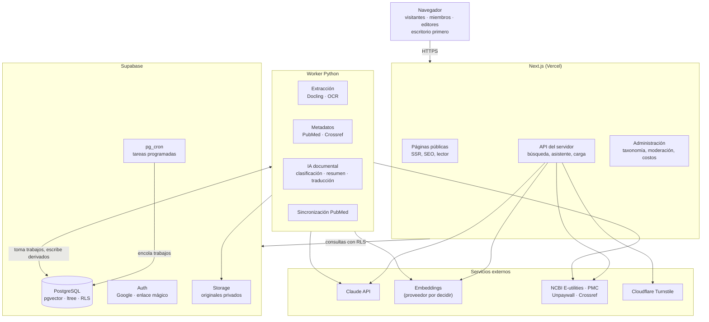

# CMF Academy — Arquitectura

**The Oral & Maxillofacial Knowledge Platform** · Creado por Dr. Juan Pablo Aravena S.

| | |
| --- | --- |
| Estado | Fase 0 aprobada para documentación. Ninguna funcionalidad implementada todavía. |
| Fecha | 25 de noviembre de 2026 |
| Rama de trabajo | `claude/sweet-ride-5juqru` → PR hacia `main` |
| Documentos relacionados | [Política de exclusión documental](politica-de-exclusion-documental.md) · [Modelo de datos](modelo-de-datos.md) · [Infraestructura](infraestructura.md) · [Costos](costos.md) · [Privacidad y cumplimiento](privacidad-y-cumplimiento.md) · [Identidad visual](identidad-visual.md) · [Plan de implementación](plan-de-implementacion.md) · [Dominio](dominio.md) · [Decisiones (ADR)](adr/README.md) |

CMF Academy se construye como un **monolito modular** en Next.js sobre **Supabase (PostgreSQL + pgvector)**, con un **worker en Python** para el procesamiento documental y **Claude** como motor de inteligencia artificial, con respuestas siempre citadas. Por decisión del administrador, la plataforma funciona con **costo cero** hasta que él apruebe explícitamente un gasto: todos los servicios parten en planes gratuitos y la IA parte apagada ([ADR-0010](adr/0010-costo-cero-y-activacion-por-fase.md)).

---

## 1. Interpretación del proyecto

CMF Academy es una **biblioteca científica pública** de Cirugía Oral y Maxilofacial, organizada como un árbol de conocimiento de profundidad libre. Cada tema funciona como un centro de conocimiento propio, que reúne una síntesis académica revisada, literatura científica, documentos, multimedia y un asistente de IA que solo afirma lo que puede citar.

- **Visitantes:** consultan el contenido público y usan el asistente con una cuota diaria.
- **Usuarios registrados:** tienen una cuota mayor, comentan y aportan material, que pasa por moderación.
- **Editores y administrador:** curan la taxonomía, verifican derechos, revisan lo generado por IA y moderan.

El valor diferencial no es almacenar PDF, sino **relacionar la evidencia con los temas** y hacerla consultable con rigor: referencias verificables, nivel de evidencia visible y separación explícita entre lo que dice la fuente y lo que interpreta la IA.

## 2. Principios de arquitectura

1. **Rigor antes que velocidad.** Una funcionalidad está terminada cuando funciona con datos reales, tiene pruebas, maneja errores, persiste lo que corresponde y está documentada.
2. **Nada simulado.** No hay datos inventados para aparentar que una integración funciona. Las pruebas de PubMed usan respuestas reales guardadas.
3. **La base de datos hace cumplir las reglas.** Derechos de autor, revisión editorial, cuotas de IA y consentimiento se validan con restricciones, triggers y RLS en PostgreSQL. La interfaz no es la única barrera.
4. **Cerrado por defecto.** Un archivo nuevo es "solo metadatos", el contenido nuevo es borrador y la IA parte apagada.
5. **Costo cero por defecto.** Ningún servicio pagado se activa sin aprobación explícita del administrador.
6. **Modular y reemplazable.** Cada dominio (taxonomía, documentos, PubMed, IA, multimedia, comunidad) es un módulo con fronteras claras. Los proveedores externos están detrás de interfaces propias.

## 3. Arquitectura técnica

| Componente | Responsabilidad | Por qué así |
| --- | --- | --- |
| **Web (Next.js)** | Páginas públicas renderizadas en el servidor, API del servidor, panel de administración | Un solo código para interfaz y API; las páginas de temas se indexan en buscadores y se comparten con enlaces estables |
| **PostgreSQL (Supabase)** | Fuente de verdad: datos, vectores, búsqueda de texto, permisos (RLS) y cola de trabajos | Un solo motor para datos relacionales, semánticos y de texto; los permisos se aplican también a la búsqueda vectorial |
| **Worker (Python)** | Todo lo lento: extracción, metadatos, IA documental, sincronización con PubMed | Python tiene las mejores herramientas para PDF científicos; separar lo lento protege la experiencia web |
| **Claude** | Asistente, resúmenes, traducciones, clasificación | Citas nativas sobre documentos, contexto de 1M tokens, caché de prompts y procesamiento por lotes con 50% de descuento |

**Por qué no microservicios:** con un equipo pequeño multiplican la operación sin aportar escala. Los módulos están separados en el código y pueden extraerse como servicios si algún día hace falta ([ADR-0002](adr/0002-monolito-modular.md)).

**Durante el piloto**, el worker corre como un flujo de **GitHub Actions** programado y bajo demanda, con costo cero ([ADR-0015](adr/0015-worker-en-github-actions-durante-el-piloto.md)). Cuando el volumen lo justifique, el mismo código se despliega como servicio permanente, previa aprobación del gasto.

## 4. Tecnologías

| Capa | Elección | Justificación | Alternativa descartada |
| --- | --- | --- | --- |
| Frontend y API | Next.js (App Router) + TypeScript | Renderizado en servidor para SEO, streaming de respuestas de IA, un solo lenguaje para interfaz y API | SPA + backend separado: el doble de piezas para el mismo resultado |
| Interfaz | Tailwind CSS + componentes accesibles (Radix/shadcn) + tokens propios | Sistema de diseño propio sin apariencia de plantilla; accesibilidad de base | Librerías de componentes cerradas, difíciles de personalizar |
| Lector de documentos | PDF.js | Estándar abierto; permite resaltar y abrir en una página exacta | Visores embebidos de terceros |
| Base de datos | PostgreSQL 15+ en Supabase | Relacional, vectores (pgvector), árboles (ltree), texto completo y trigramas en un solo motor | Base vectorial separada: otra cuenta, otra sincronización, otro costo |
| Autenticación | Supabase Auth (Google y enlace mágico; doble factor para editores) | Integrada con RLS: los permisos viven junto a los datos | Auth0, Clerk: costo y otra integración |
| Archivos | Supabase Storage (buckets privados, URL firmadas) | Mismas políticas de acceso que la base | Cloudflare R2 o Backblaze B2 si el volumen supera el plan gratuito |
| Procesamiento | Python 3.12 con Docling y PyMuPDF | Mejor extracción de PDF a dos columnas, tablas y páginas | Extracción en Node, notablemente peor en PDF científicos |
| Cola de trabajos | Tabla en PostgreSQL con `FOR UPDATE SKIP LOCKED` | Sin infraestructura extra; reintentos, estados y costos visibles; probada en la fase 0 | Redis, SQS: innecesarios a esta escala |
| Tareas programadas | pg_cron (encola) + worker | Las actualizaciones de PubMed no dependen de los límites de tiempo del hosting | Cron del hosting, con límites de duración |
| IA | Claude: Haiku 5.5, Sonnet 5.5 y Opus 5.5 según la tarea | Ver sección 6 | — |
| Embeddings | Por decidir en la fase 4 ([ADR-0014](adr/0014-proveedor-de-embeddings.md)) | Dimensión 1024 fijada para que el cambio de proveedor no altere el esquema | — |
| Búsqueda global | PostgreSQL: texto completo + trigramas + vectores; sinónimos MeSH y DeCS | Busca temas, obras, autores y conceptos en español e inglés sin otro servicio | Meilisearch o Typesense si el volumen lo exige |
| Antibots | Cloudflare Turnstile (gratuito) | Protege el asistente público y los formularios | reCAPTCHA, más invasivo |
| Observabilidad | Sentry (plan gratuito) + registro de uso y costo de IA en la base | Errores visibles; costo por usuario, por función y por mes | — |
| Calidad | Pruebas SQL, Vitest, Playwright, GitHub Actions | Cada PR hacia `main` pasa por pruebas automáticas | — |

## 5. Modelo de datos

El modelo separa la **obra** (referencia bibliográfica), el **archivo** (el original intacto) y los **derivados** (extracción, fragmentos, traducción, resumen). Una obra puede existir como ficha de PubMed sin archivo, y un archivo restringido puede tener derivados que nunca serán más abiertos que él.

El esquema completo está en [`supabase/migrations/`](../supabase/migrations) y se documenta en [modelo-de-datos.md](modelo-de-datos.md). En la fase 0 se validó con **8 archivos de pruebas** contra PostgreSQL 16 con pgvector, incluida una prueba de mutación (se introdujeron defectos a propósito para comprobar que las pruebas los detectan).

Reglas que el esquema hace cumplir, no solo la interfaz:

- Un archivo es **público** solo si un editor verificó y registró la base legal de su distribución.
- La IA procesa un archivo solo si tiene **autorización registrada** (`ai_processing_allowed`).
- La búsqueda semántica de un visitante **nunca devuelve fragmentos restringidos** (probado).
- Un derivado **no puede ser más abierto** que su archivo, y si el archivo se restringe, sus derivados lo siguen.
- Lo generado por IA **no se publica sin aprobación de un editor**.
- Una **imagen clínica** no se publica sin consentimiento y anonimización verificados.
- Las **cuotas diarias** (3 visitantes, 10 registrados) y el **presupuesto global** se aplican de forma atómica en la base.
- **No puede quedar la plataforma sin administrador**, y los cambios sensibles quedan en una auditoría de solo inserción.

## 6. Inteligencia artificial y RAG

El asistente responde con lo que puede citar: fragmentos de la biblioteca (con enlace al documento y a la página) o registros de PubMed (con enlace al PMID). Si no encuentra respaldo, lo dice.

**Ingesta (en el worker):**

1. Extraer texto con estructura: secciones, tablas, figuras y números de página.
2. Fragmentar por sección (400 a 800 tokens, 10 a 15% de solapamiento, sin cortar tablas).
3. Contextualizar cada fragmento con 1 o 2 frases (Haiku 5.5 con caché de prompts).
4. Generar embeddings (1024 dimensiones) y el índice de texto completo.
5. Completar metadatos con PubMed y Crossref a partir del DOI o PMID.

**Consulta:**

1. Reformular la pregunta: traducción al inglés y expansión con términos MeSH.
2. Búsqueda híbrida (vectorial + léxica, fusión por Reciprocal Rank Fusion) **ejecutada con los permisos del usuario**: un visitante solo recupera fragmentos públicos.
3. Reordenar y quedarse con los 8 a 12 mejores.
4. Generar la respuesta con citas nativas de la API.
5. Validar cada referencia contra `works` o contra NCBI antes de mostrarla; una referencia inexistente se elimina y se registra.

**Modos (documento maestro, sección 7):**

| Modo | Herramientas | Modelo |
| --- | --- | --- |
| Tutor | Biblioteca del tema | Sonnet 5.5 |
| Investigador | Biblioteca + PubMed en vivo | Sonnet 5.5 con herramientas |
| Comparador | Biblioteca + PubMed; tablas con cita por celda | Opus 5.5 |
| Organizador | Base de datos (solo editores); propone, no decide | Haiku 5.5 |
| Crítico científico | Texto completo o abstract; RoB 2 o ROBINS-I | Opus 5.5 |

**Cómo se hacen cumplir las 12 reglas científicas:** las citas apuntan por clave foránea a fragmentos u obras registradas (no se puede citar un PMID inexistente); cada fuente declara si se leyó el texto completo o solo el abstract; la respuesta separa "Evidencia" de "Interpretación"; el set de evaluación incluye preguntas trampa sobre artículos inexistentes y corre en CI antes de cada cambio de prompts.

**Control de costos:** ruteo por modelo, caché de prompts, lotes con 50% de descuento, tope de tokens de salida, cuotas diarias, presupuesto mensual con alerta al 80% y corte automático, e interruptor manual ([ADR-0007](adr/0007-acceso-publico-a-la-ia.md)).

## 7. PubMed y fuentes científicas

Ver [ADR-0009](adr/0009-pubmed-fuente-de-verdad-bibliografica.md) y el plan de la fase 3.

| Necesidad | Servicio | Uso |
| --- | --- | --- |
| Búsqueda por palabra clave, autor, año, tipo de estudio, patología o procedimiento | ESearch | Consulta construida desde el tema: MeSH + sinónimos + filtros `[pt]` |
| Metadatos completos | EFetch (XML), ESummary | Normalizados en `works`, `authors`, `journals`, `work_mesh` |
| Artículos relacionados y enlaces a PMC | ELink | Relacionados por obra; detección de PMCID |
| Texto completo de acceso abierto | PMC OA Web Service, BioC | Solo con licencia compatible, registrada |
| Texto completo legal fuera de PMC | Unpaywall | Enlace a la versión de acceso abierto |
| Libros y artículos sin PMID | Crossref | Completa la ficha de documentos subidos |
| Conversión PMID, PMCID, DOI | PMC ID Converter | Deduplicación |
| Términos en español | DeCS (BIREME) | Búsqueda en español equivalente a MeSH |

Cada tema puede tener consultas guardadas con frecuencia configurable (semanal por defecto). `pg_cron` llama a `enqueue_due_pubmed_syncs()` y el worker ejecuta la búsqueda. Los registros nuevos se muestran como "Publicaciones recientes"; su asignación a temas queda **sin confirmar** hasta que un editor la revise. **Nunca se incorporan textos completos automáticamente**: solo registros bibliográficos con sus enlaces.

## 8. Procesamiento documental

El original se conserva intacto; todo lo demás es un derivado ligado a él. Cada etapa es un trabajo de la cola con estado, reintentos y costo registrado:

0. **Política de exclusión:** antes de copiar nada, cada archivo (de Google Drive, de una carga directa o de un aporte) se clasifica y registra en el inventario de importación. Solo lo permitido se copia; DICOM, proyectos de planificación, casos clínicos, datos de pacientes, presentaciones y duplicados quedan fuera, y lo dudoso en cuarentena ([política](politica-de-exclusion-documental.md), [ADR-0016](adr/0016-politica-de-exclusion-documental.md)).
1. **Recepción:** tipo real del archivo (no solo la extensión), tamaño máximo, análisis antivirus, SHA-256 y detección de duplicados.
2. **Extracción:** Docling para PDF, DOCX y PPTX; OCR para escaneados. Las secciones que no se pudieron extraer se informan.
3. **Metadatos:** DOI y PMID desde el texto, consulta a PubMed y Crossref; lo extraído sin identificador queda como "extraído automáticamente".
4. **Clasificación:** la IA propone temas, tipo de estudio, nivel de evidencia y conceptos; el editor confirma.
5. **Indexación RAG** (sección 6).
6. **Resumen estructurado** con los 16 campos del documento maestro. Cada campo distingue "lo que dice el documento" (con página) de "interpretación de la IA"; un dato ausente queda como "No reportado".
7. **Traducción** por secciones, conservando títulos, tablas, unidades, valores estadísticos y referencias, con glosario de la especialidad. Es un documento independiente enlazado al original.
8. **Revisión y publicación** por un editor.

Los pasos 4, 6 y 7 usan IA y, por lo tanto, quedan **inactivos hasta que se apruebe un presupuesto**. Los pasos 1, 2, 3, 5 (con embeddings gratuitos o diferidos) y 8 funcionan con costo cero.

## 9. Navegación e interfaz

Barra lateral persistente con las siete secciones del documento maestro: **Inicio, Biblioteca, Investigación, Asistente IA, Multimedia, Comunidad y Acerca de**. Arriba, la búsqueda global (⌘K / Ctrl+K). La administración aparece solo para editores.

La página de cada tema tiene encabezado (ruta, nombre, descripción, última actualización, número de documentos, "revisado por") y las secciones A a H del documento maestro, con índice lateral fijo y el asistente del tema en un panel derecho. La literatura se muestra como tabla densa y ordenable, no como tarjetas grandes.

La identidad visual provisional está en [identidad-visual.md](identidad-visual.md), con un espécimen navegable en [`docs/diseno/especimen.html`](diseno/especimen.html).

## 10. Seguridad

- Permisos en la base (RLS) y en el servidor; nunca solo en la interfaz.
- Claves de API únicamente en variables de entorno del servidor ([`.env.example`](../.env.example)).
- Validación de entradas con esquemas en cada endpoint; validación de archivos antes de procesarlos.
- Archivos privados servidos con URL firmadas de corta duración, previa verificación de su estado de distribución.
- Antibots, cuotas, presupuesto e interruptor para la IA.
- Contenido de documentos tratado como datos, nunca como instrucciones; el asistente público no tiene herramientas que modifiquen datos.
- Doble factor para editores y administradores; auditoría de solo inserción.
- Respaldos: ver [infraestructura.md](infraestructura.md).

Privacidad, datos sensibles e imágenes clínicas: [privacidad-y-cumplimiento.md](privacidad-y-cumplimiento.md).

## 11. Riesgos principales

| Riesgo | Mitigación |
| --- | --- |
| Distribuir material protegido por derechos de autor | Estados de distribución aplicados en la base; derechos verificados por un editor; formulario de retiro |
| Respuestas de IA con referencias inventadas | Citas por clave foránea, validación contra NCBI, set de evaluación con preguntas trampa |
| Costo de IA sin control | IA apagada por defecto, presupuesto, cuotas, corte automático y aprobación explícita de gastos |
| Exposición de datos de pacientes | Política de exclusión aplicada antes de importar; consentimiento y anonimización obligatorios en la base; metadatos EXIF eliminados; revisión editorial |
| Límites de planes gratuitos (500 MB de base, 1 GB de archivos, pausa por inactividad en Supabase Free) | Monitoreo de uso; respaldo propio; decisión de pago solo cuando se acerque el límite |
| Términos de uso de Vercel Hobby (uso personal, no comercial) | El proyecto no tiene fines de lucro; si eso cambia, migrar a otro plan o a Cloudflare con aprobación |
| Cambio normativo (Ley 21.719, vigencia modificada por la Ley 21.855) | Diseño conforme desde el inicio y revisión legal antes del lanzamiento |
| Dependencia de proveedores | Interfaces propias para IA, embeddings y almacenamiento; PostgreSQL estándar |
| Alcance demasiado amplio | Ocho fases con criterios de salida; cada fase se revisa y aprueba por PR |

## 12. Decisiones confirmadas en la fase 0

| # | Decisión | Dónde se aplica |
| --- | --- | --- |
| 1 | Tres estados de distribución: público, restringido, solo metadatos. La IA procesa solo con autorización o base legítima | [ADR-0006](adr/0006-obra-archivo-derivados-y-distribucion.md), migración 0400, prueba 03 |
| 2 | IA pública: 3 consultas diarias para visitantes y 10 para registrados, con antibots, control de tokens, presupuesto global y restricción temporal | [ADR-0007](adr/0007-acceso-publico-a-la-ia.md), migración 0600, prueba 05 |
| 3 | Lo redactado por IA queda en borrador hasta la aprobación de un editor; el administrador principal es Dr. Juan Pablo Aravena S. | [ADR-0008](adr/0008-revision-editorial-obligatoria.md), migraciones 0200 y 0400, prueba 04 |
| 4 | Presupuesto: **costo cero**. No se activa nada que cobre sin aprobación explícita | [ADR-0010](adr/0010-costo-cero-y-activacion-por-fase.md), [costos.md](costos.md) |
| 5 | Servicios por fase: primero Supabase, Vercel y Anthropic (este último solo con aprobación); después NCBI, embeddings, Cloudflare, Sentry y correo | [infraestructura.md](infraestructura.md) |
| 6 | Dominio: no se compra todavía | [dominio.md](dominio.md) |
| 7 | Contenido inicial: Anatomía quirúrgica, Cirugía ortognática, ATM, Crecimiento y desarrollo craneofacial, Traumatología maxilofacial | [`supabase/seed.sql`](../supabase/seed.sql), prueba 02 |
| 8 | Identidad tipográfica provisional; sin logotipo definitivo. Acento definitivo: verde petróleo (26-11-2026); modo claro y oscuro | [identidad-visual.md](identidad-visual.md), [ADR-0011](adr/0011-identidad-visual-provisional.md) |
| 9 | Ley 21.719: vigencia modificada al 15 de octubre de 2027 por la Ley 21.855 | [privacidad-y-cumplimiento.md](privacidad-y-cumplimiento.md) |
| 10 | Política de exclusión documental obligatoria: sin DICOM, proyectos de planificación, casos clínicos, datos de pacientes ni presentaciones; libros permitidos; una copia por documento | [politica-de-exclusion-documental.md](politica-de-exclusion-documental.md), [ADR-0016](adr/0016-politica-de-exclusion-documental.md), migración 0800, prueba 09 |

## 13. Roadmap

| Fase | Contenido | Costo previsto |
| --- | --- | --- |
| 0. Diseño y configuración | Esta documentación, modelo de datos probado, CI, identidad provisional | US$0 |
| 1. Fundamentos | Sistema de diseño, navegación, dashboard con datos reales, taxonomía editable, páginas de tema, auth y roles | US$0 |
| 2. Gestión documental | Importador de Google Drive con política de exclusión, carga, pipeline, metadatos, lector PDF, estados de distribución; resúmenes y traducción cuando haya presupuesto | US$0 sin IA |
| 3. PubMed | E-utilities, búsqueda y filtros, fichas, sincronización programada | US$0 |
| 4. Inteligencia artificial | RAG, asistente general y por tema, modos, citas verificadas, cuotas | Requiere aprobación de gasto |
| 5. Multimedia | Galerías, visor, video, esquemas, 3D, flujo de consentimiento | US$0 con video externo |
| 6. Comunidad | Registro abierto, perfiles, aportes, comentarios, moderación | US$0 |
| 7. Herramientas académicas | Flashcards, evaluaciones, casos, algoritmos, presentaciones | Según uso de IA |

El detalle por PR y los criterios de salida están en [plan-de-implementacion.md](plan-de-implementacion.md).
