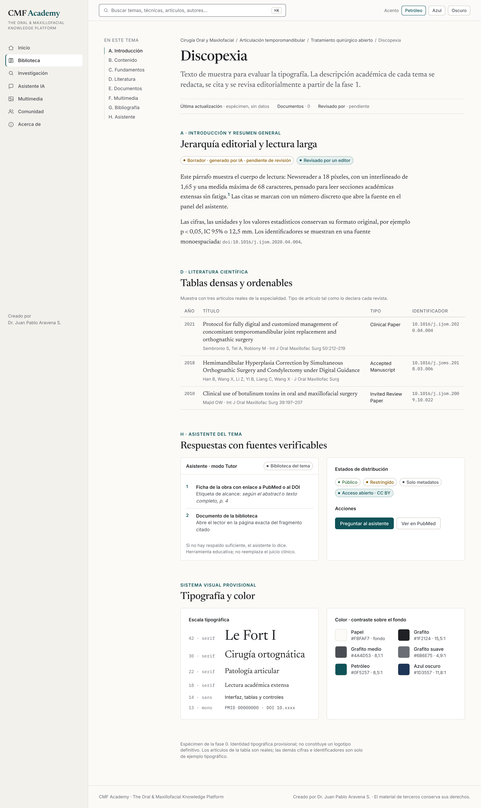

# Identidad visual provisional

**Estado: provisional** ([ADR-0011](adr/0011-identidad-visual-provisional.md)). No hay logotipo definitivo aprobado. Estos lineamientos sirven de punto de partida para el sistema de diseño de la fase 1.

Espécimen navegable: [`docs/diseno/especimen.html`](diseno/especimen.html). Se abre en cualquier navegador y permite cambiar el acento (petróleo o azul) y el modo oscuro. Tokens: [`docs/diseno/tokens.css`](diseno/tokens.css).

## Dirección

Una publicación científica antes que una aplicación: el contenido manda y la interfaz se retira. Fondo blanco cálido, texto grafito, un solo color de acento, espacios amplios, bordes finos en lugar de sombras y tablas densas para la literatura. Se evitan degradados decorativos, tarjetas grandes, exceso de color y apariencia de plantilla.

## Tipografía

| Uso | Familia | Por qué |
| --- | --- | --- |
| Títulos y lectura larga | **Newsreader** (serif, con tamaños ópticos) | Diseñada para lectura en pantalla; tono editorial y académico; los tamaños ópticos mantienen la elegancia en títulos grandes y la legibilidad en el cuerpo |
| Interfaz, tablas, controles | **Inter** | Muy legible en tamaños pequeños; cifras tabulares para datos |
| DOI, PMID, valores técnicos | **IBM Plex Mono** | Distingue identificadores que se copian y verifican |

Las tres tienen licencia SIL Open Font License: son gratuitas y se pueden alojar en el propio sitio (la fase 1 las servirá con `next/font`, sin depender de Google Fonts en producción).

**Escala (6 niveles, base 16 px):** 42 título de tema · 30 sección · 22 subtítulo · 18 lectura (serif, interlineado 1,65, máximo 68 caracteres por línea) · 14–16 interfaz · 13 metadatos.

## Color

| Token | Valor | Contraste sobre el fondo | Uso |
| --- | --- | --- | --- |
| Papel | `#FBFAF7` | — | Fondo blanco cálido |
| Superficie | `#F3F1EC` | — | Barra lateral, paneles |
| Grafito | `#1F2124` | 15,5:1 | Texto principal |
| Grafito medio | `#4A4D53` | 8,1:1 | Texto secundario |
| Grafito suave | `#6B6E75` | 4,9:1 | Metadatos; borde de campos de formulario |
| **Petróleo** (recomendado) | `#0F5257` | 8,5:1 | Acento: enlaces, acciones, sección activa |
| Azul oscuro (alternativa) | `#1D3557` | 11,8:1 | Acento alternativo |

Todos los textos cumplen WCAG 2.2 nivel AA (mínimo 4,5:1); grafito, grafito medio y ambos acentos cumplen además AAA (7:1). Los colores semánticos (verde, ámbar, rojo apagados) se reservan para estados y niveles de evidencia.

**Recomendación de acento: verde petróleo.** El azul oscuro es el color por defecto de muchas plataformas institucionales y de software genérico; el petróleo da una identidad más propia, mantiene la sobriedad científica y conserva excelente contraste. La decisión final es tuya: en el espécimen puedes comparar ambos.

## Logotipo provisional

Logotipo tipográfico: "CMF" en grafito y "Academy" en el color de acento, en Newsreader seminegrita, con el subtítulo "The Oral & Maxillofacial Knowledge Platform" en versalitas pequeñas. **No es un logotipo definitivo**: un símbolo propio podrá diseñarse más adelante.

## Principios de interfaz

- Barra lateral persistente a la izquierda (264 px) y búsqueda global siempre visible.
- Columna de lectura de unos 720 px con índice lateral fijo en las páginas de tema.
- Cuadrícula de 8 px, bordes de 1 px, radios de 6 px, transiciones de 150 a 200 ms (desactivadas si el usuario prefiere menos movimiento).
- Un solo set de iconos de trazo fino.
- Modo oscuro opcional con los mismos niveles de contraste.
- Escritorio primero; en teléfono, sin desplazamiento horizontal (verificado en el espécimen a 390 px).
- Créditos institucionales en el pie de página y en "Acerca de".
