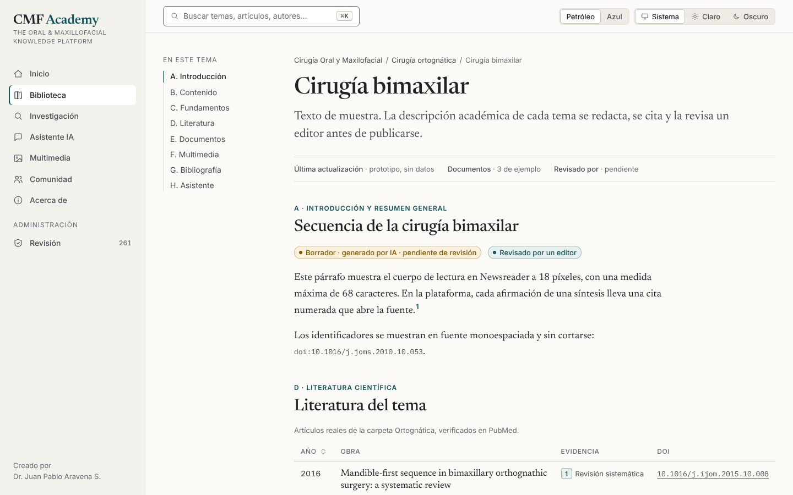
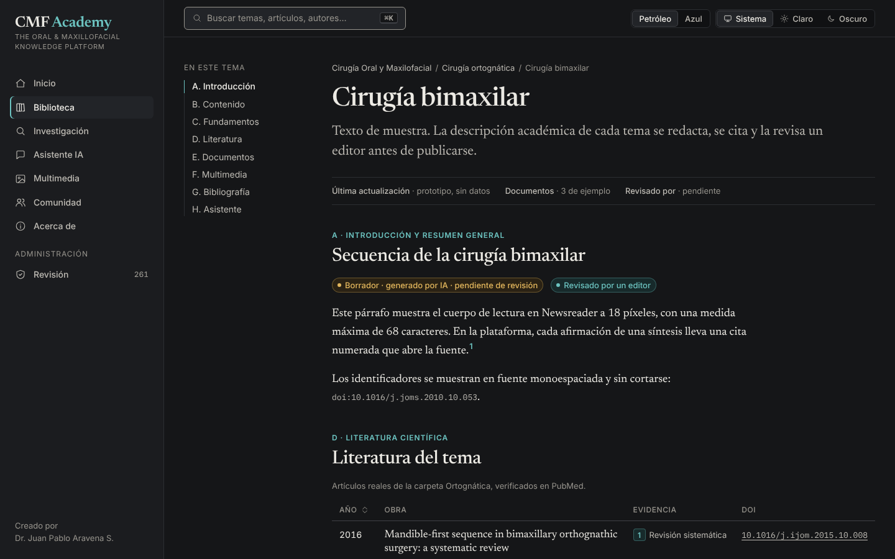

# Identidad visual y sistema de diseño

**Estado:** sistema de diseño v2, con modo claro y oscuro. **Acento definitivo: verde petróleo** (decisión del administrador, 26-11-2026). El logotipo sigue siendo provisional ([ADR-0011](adr/0011-identidad-visual-provisional.md)).

| Modo claro | Modo oscuro |
| --- | --- |
|  |  |

## Archivos

| Archivo | Contenido |
| --- | --- |
| [`apps/web/src/styles/tokens.css`](../apps/web/src/styles/tokens.css) | Tokens: tipografía, escala, espaciado, forma, movimiento y colores de modo claro y oscuro. Fuente única: la usan la aplicación y el prototipo |
| [`apps/web/src/styles/estilos.css`](../apps/web/src/styles/estilos.css) | Estilos base y componentes; usan solo tokens, sin colores fijos |
| [`apps/web/src/components/ThemeToggle.tsx`](../apps/web/src/components/ThemeToggle.tsx) | Selector de tema (Sistema, Claro, Oscuro) de la aplicación, con memoria en el navegador y sin destello al cargar |
| Ruta `/componentes` de la aplicación | Galería viva de tokens y componentes, para revisarlos en ambos modos |
| [`diseno/tema.js`](diseno/tema.js) | Selector de tema del prototipo estático |
| [`diseno/prototipo.html`](diseno/prototipo.html) | Prototipo navegable: Inicio, Biblioteca, página de tema, Asistente y Revisión de importación |
| [`diseno/especimen.html`](diseno/especimen.html) | Espécimen tipográfico original de la fase 0 |

Para ver el prototipo, abre `docs/diseno/prototipo.html` en un navegador desde una copia local del repositorio. GitHub muestra los HTML como código, no como página. La aplicación real se levanta con `pnpm dev` (ver el README).

## Dirección

Una publicación científica antes que una aplicación: el contenido manda y la interfaz se retira. Fondo cálido, texto grafito, un solo color de acento, espacios amplios, bordes finos en lugar de sombras y tablas densas para la literatura. Se evitan degradados decorativos, tarjetas grandes, exceso de color y apariencia de plantilla.

## Modo claro y oscuro

- **Por defecto sigue al sistema operativo** (`prefers-color-scheme`). El selector de la barra superior permite fijar Claro u Oscuro; la elección se recuerda en el navegador y se aplica antes de pintar, sin destello.
- El modo oscuro es grafito cálido (`#151618`), no negro puro. Los colores se aclaran para conservar el contraste y el texto sobre el acento pasa a ser oscuro (`--color-on-accent`); en el espécimen de la fase 0 era blanco y no alcanzaba el contraste mínimo.
- Los componentes no usan colores fijos: cambiar de tema solo cambia los tokens.
- Se respeta `prefers-reduced-motion` (sin transiciones).

## Tipografía

| Uso | Familia | Por qué |
| --- | --- | --- |
| Títulos y lectura larga | **Newsreader** (serif, con tamaños ópticos) | Diseñada para lectura en pantalla; tono editorial y académico |
| Interfaz, tablas, controles | **Inter** | Muy legible en tamaños pequeños; cifras tabulares |
| DOI, PMID, valores técnicos | **IBM Plex Mono** | Distingue los identificadores que se copian y verifican; no se cortan entre líneas |

Las tres tienen licencia SIL Open Font License y la aplicación las sirve desde el propio sitio con los paquetes de Fontsource, sin llamar a Google Fonts (sin rastreo de terceros y sin depender de su disponibilidad).

**Escala (base 16 px):** 42 título de tema · 30 sección · 22 subtítulo · 18 lectura (serif, interlineado 1,65, máximo 68 caracteres por línea) · 14–16 interfaz · 13 metadatos · 12 etiquetas en versalitas.

## Color

| Token | Claro | Oscuro | Uso |
| --- | --- | --- | --- |
| `--color-paper` | `#FBFAF7` | `#151618` | Fondo de página |
| `--color-surface` | `#F3F1EC` | `#1B1C1F` | Barra lateral, paneles secundarios |
| `--color-raised` | `#FFFFFF` | `#222428` | Tarjetas, menús, campos |
| `--color-ink` | `#1F2124` | `#ECEAE4` | Texto principal |
| `--color-ink-2` | `#4A4D53` | `#BDBAB3` | Texto secundario |
| `--color-ink-3` | `#686B72` | `#97948D` | Metadatos; borde de campos |
| `--color-accent` (verde petróleo) | `#0F5257` | `#6CC3C0` | Enlaces, acciones, sección activa |
| `--color-on-accent` | `#FFFFFF` | `#0B1C1D` | Texto sobre el acento |
| `--color-ok` · `warn` · `critical` · `info` | apagados | aclarados | Estados, avisos y niveles de evidencia; cada uno con su fondo `-tint` |

**Contraste verificado automáticamente.** [`scripts/check_contrast.py`](../scripts/check_contrast.py) revisa 36 pares de texto y fondo en modo claro y en modo oscuro y corre en la CI. Todos cumplen WCAG 2.2 AA: 4,5:1 para texto y 3:1 para bordes de controles y foco. El par más ajustado es el texto de metadatos sobre la barra lateral en modo claro, con 4,73:1. La prueba también exige que el modo oscuro del sistema y el elegido a mano definan los mismos colores.

**Acento:** verde petróleo, elegido por el administrador el 26-11-2026. Da una identidad propia, distinta del azul institucional genérico, y mantiene la sobriedad científica. El azul oscuro se descartó.

## Componentes

Incluidos en `estilos.css` y usados en el prototipo:

- **Estructura:** barra lateral persistente (264 px) que en el teléfono pasa a ser un menú deslizable que se cierra con Escape; barra superior con búsqueda global (⌘K / Ctrl+K) y selector de tema.
- **Contenido:** migas de pan, índice lateral del tema, título, entradilla, metadatos, cuerpo de lectura y citas numeradas.
- **Datos:** tablas densas y ordenables con DOI sin cortes, insignias de estado y de distribución, nivel de evidencia y cifras.
- **Acciones y formularios:** botones (principal, secundario, discreto, peligro, pequeño, solo icono), controles segmentados, campos, selectores, casillas y avisos (información, advertencia, crítico, correcto).
- **Navegación y asistente:** pestañas, árbol de temas, paneles, y el asistente con sus mensajes, la separación entre «lo que dicen las fuentes» y «la interpretación», la lista de fuentes y el cuadro de escritura.

## Logotipo provisional

Logotipo tipográfico: «CMF» en grafito y «Academy» en el color de acento, en Newsreader seminegrita, con el subtítulo «The Oral & Maxillofacial Knowledge Platform» en versalitas pequeñas. **No es un logotipo definitivo.**

## Principios de interfaz

- Cuadrícula de 4/8 px, bordes de 1 px, radios de 6 px (10 px en paneles), transiciones de 150 a 200 ms.
- Un solo set de iconos de trazo fino (1,5 px).
- Foco visible en todos los controles; navegación completa con teclado.
- Escritorio primero; en el teléfono, sin desplazamiento horizontal (verificado a 390 px).
- Los datos de ejemplo del prototipo se rotulan como tales; los artículos que muestra son reales y están verificados en PubMed.
- Créditos institucionales en la barra lateral y en el pie de página.
