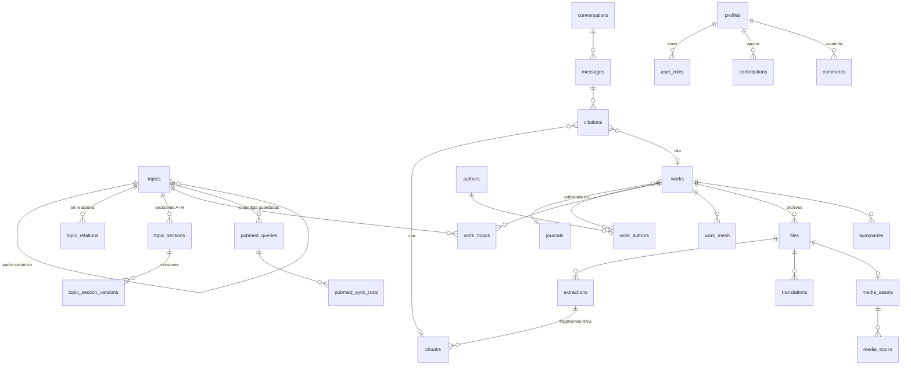

# Modelo de datos

El esquema está escrito como migraciones SQL en [`supabase/migrations/`](../supabase/migrations) y validado con las pruebas de [`supabase/tests/`](../supabase/tests). En la fase 0 es un **borrador de diseño probado**: no se ha aplicado en ningún proyecto de Supabase. La fase 1 lo aplicará en un proyecto gratuito y podrá ajustarlo mientras ningún entorno con datos reales dependa de él.

## Diagrama de entidades principales



## Catálogo de tablas

| Migración | Tabla | Propósito |
| --- | --- | --- |
| 0100 núcleo | `profiles` | Perfil público de cada cuenta (minimización de datos) |
| | `user_roles` | Roles `member` < `editor` < `admin`; el visitante es el rol `anon` de Supabase |
| | `app_settings` | Configuración editable sin código: cuotas, presupuesto, interruptor de IA |
| | `audit_log` | Auditoría de solo inserción de cambios sensibles |
| 0200 taxonomía | `topics` | Árbol de profundidad libre con ruta materializada (`ltree`) |
| | `topic_relations` | Relaciones tipadas entre temas de distintas ramas |
| | `topic_sections`, `topic_section_versions` | Secciones académicas de cada tema, versionadas y con revisión editorial |
| 0300 bibliografía | `works` | Obra científica: metadatos, identificadores, nivel de evidencia, licencia |
| | `journals`, `authors`, `work_authors` | Revistas y autores normalizados |
| | `mesh_terms`, `work_mesh` | Descriptores MeSH |
| | `work_topics` | Obra ↔ tema; la IA propone, el editor confirma |
| 0400 archivos | `files` | Archivo original, estado de distribución, base legal y permiso de IA |
| | `file_access_grants` | Accesos individuales a archivos restringidos |
| | `extractions`, `chunks` | Texto estructurado y fragmentos con embedding `vector(1024)` |
| | `translations`, `summaries` | Derivados con revisión editorial y distribución heredada |
| | `media_assets`, `media_topics` | Multimedia con reglas de consentimiento y anonimización |
| 0500 cola y PubMed | `processing_jobs` | Cola de trabajos del worker con reintentos y costo |
| | `pubmed_queries`, `pubmed_sync_runs` | Consultas guardadas por tema y su historial |
| 0600 IA | `conversations`, `messages`, `citations` | Conversaciones privadas y citas verificables |
| | `ai_usage`, `ai_quota_counters` | Consumo, costo y cuotas diarias |
| 0700 comunidad | `contributions`, `comments` | Aportes y discusión con moderación |
| | `copyright_requests` | Solicitudes de retiro por derechos de autor |
| | `content_events` | Historial público de actualizaciones |

Correspondencia con las entidades pedidas por el documento maestro (sección 12): usuarios → `profiles`; roles y permisos → `user_roles` + RLS; categorías, subcategorías y temas → `topics` (un solo tipo de nodo, profundidad libre); relaciones entre temas → `topic_relations`; documentos y archivos originales → `works` + `files`; traducciones → `translations`; resúmenes → `summaries`; referencias y artículos → `works`; autores → `authors`; revistas → `journals`; imágenes y videos → `media_assets`; comentarios → `comments`; aportes → `contributions`; procesamiento → `processing_jobs` + `extractions`; historial → `content_events` + `audit_log`.

## Decisiones de diseño

- **Un solo tipo de nodo para la taxonomía.** Especialidad, categoría, subcategoría, tema y subtema son el mismo registro a distinta profundidad. Agregar un nivel no requiere cambiar código ([ADR-0005](adr/0005-taxonomia-de-profundidad-libre.md)). La prueba 02 crea un sexto nivel y mueve subárboles completos.
- **Obra ≠ archivo.** La ficha bibliográfica se comparte y es pública; el archivo tiene su propio estado de distribución ([ADR-0006](adr/0006-obra-archivo-derivados-y-distribucion.md)).
- **Embeddings de 1024 dimensiones.** Compatibles con todos los candidatos evaluados, para que cambiar de proveedor no altere el esquema ([ADR-0014](adr/0014-proveedor-de-embeddings.md)).
- **Cola en PostgreSQL.** `claim_jobs()` usa `FOR UPDATE SKIP LOCKED`; `fail_job()` reintenta con espera creciente ([ADR-0003](adr/0003-postgresql-como-fuente-de-verdad.md)).
- **Configuración en la base.** Cuotas, presupuesto e interruptor de IA están en `app_settings`, editables por el administrador y auditados.

## Seguridad en la base de datos

- Todas las tablas tienen RLS activada (la prueba 01 lo verifica para cualquier tabla nueva).
- Toda función `SECURITY DEFINER` fija su `search_path` (también verificado).
- Las funciones de operación interna (`claim_jobs`, `ai_try_consume`, `ai_record_usage`, `enqueue_due_pubmed_syncs`…) no son invocables por `anon` ni `authenticated`; solo por el servidor (`service_role`).
- Las vistas usan `security_invoker` para respetar la RLS de quien consulta.
- **Lección registrada:** dentro de una función `SECURITY DEFINER`, `current_user` es el dueño de la función. La primera versión de `ai_budget_status()` lo pasaba por alto; la prueba 05 lo detectó y se corrigió usando el rol del JWT.

## Cómo ejecutar las pruebas

Requiere PostgreSQL 15 o superior con las extensiones `vector`, `ltree`, `pg_trgm`, `unaccent` y `citext`.

```bash
PGHOST=localhost PGUSER=postgres supabase/tests/run.sh
```

El script crea una base desechable, aplica una simulación mínima de Supabase ([`supabase/tests/support/supabase_stub.sql`](../supabase/tests/support/supabase_stub.sql)), las migraciones, la semilla (dos veces, para comprobar que es idempotente) y luego cada prueba dentro de una transacción que se revierte. El mismo script corre en GitHub Actions contra PostgreSQL 16 y 17.

| Prueba | Qué verifica |
| --- | --- |
| 01 estructura | RLS en todas las tablas, claves primarias, `search_path` en funciones privilegiadas, funciones internas no expuestas, valores iniciales seguros |
| 02 taxonomía | Semilla de 51 nodos, profundidad libre, mover subárboles, prevención de ciclos, slugs únicos entre hermanos, publicación jerárquica, permisos |
| 03 derechos y archivos | Verificación de derechos, visibilidad por estado de distribución y por concesión individual, permiso de IA, aislamiento de fragmentos restringidos en búsqueda semántica, herencia de restricciones |
| 04 revisión editorial | Borrador obligatorio para IA, aprobación solo por editores, visibilidad pública de lo aprobado, alcance declarado de los resúmenes |
| 05 IA | Cuotas 3/10, cuotas editables, alerta al 80%, corte por presupuesto, interruptor manual, auditoría, funciones no invocables por clientes |
| 06 cola y PubMed | Tomas sin duplicados, filtro por tipo, costo, reintentos con espera, falla definitiva, programación de sincronizaciones sin duplicar |
| 07 comunidad y roles | Perfil automático, escalamiento de privilegios bloqueado, último administrador protegido, moderación de aportes y comentarios |
| 08 multimedia y privacidad | Imágenes clínicas como dato de paciente, consentimiento y anonimización antes de publicar |

## Pendiente para fases posteriores

- Políticas de Storage (`storage.objects`) para los buckets `originals` y `media` (fase 2; dependen del esquema propio de Supabase).
- Función de búsqueda híbrida y su índice afinado (fase 4).
- Programación de `pg_cron` (fase 3).
- Índices adicionales según los planes de consulta reales.
